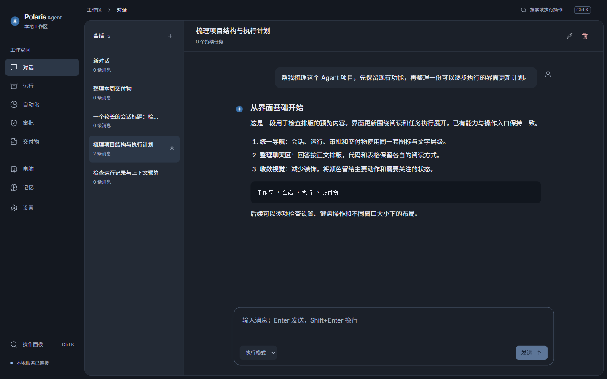

<div align="center">
  
  <h1>Polaris Agent · 北极星</h1>
  <p>一个在学习 Agent 的过程中，自己尝试搭建的本地智能体项目。</p>
  <p>简体中文 · <a href="README.en.md">English</a></p>
</div>

## 关于这个项目

我在学习 Agent 之余，想自己动手把对话、工具调用、任务执行和桌面界面串起来，于是有了 Polaris Agent。

这个仓库主要用来记录我的学习与实践。我会随着学习进度不定期更新，尝试新的能力，也会继续改进已有实现。目前仍是个人实验项目，功能和接口可能变化，欢迎交流、提 Issue 或分享建议。

## 界面预览



*预览使用演示对话内容。应用支持跟随系统切换浅色与深色外观，界面目前以中文为主。*

## 目前实现了什么

- **对话与工具执行**：流式回答、推理片段、工具进度，支持普通模式与计划模式。
- **运行记录**：查看执行步骤、检查点、用量和 Trace，支持中断与恢复。
- **审批**：敏感操作确认，电脑操作可通过独立置顶窗口审批。
- **自动化**：一次性、间隔和 Cron 任务。
- **交付物**：文件与链接的展示、预览和下载。
- **记忆与持续任务**：核心记忆、跨会话搜索、运行后反思，以及带步骤的任务。
- **扩展**：Skill 安装与管理、MCP Server 配置和导入。
- **模型配置**：OpenAI、DeepSeek、Qwen 和 Anthropic。
- **电脑操作实验**：macOS 原生 Helper，支持截图、可访问性观察、点击、输入和窗口聚焦。

这些能力仍在迭代，实际可用范围受模型、系统权限和平台限制影响。

## 结构

```text
desktop/                     React + TypeScript + Vite / Electron 桌面端
backend/kore_next/           Python Host：Agent、工具、记忆、审批与调度
backend/tests/               后端测试
native/macos-computer-helper/ Swift 电脑操作辅助程序
scripts/                     Windows 启动、图标和快捷方式脚本
docs/                        项目展示资源
```

桌面端通过 WebSocket JSON-RPC 与本地 Python Host 通信。默认服务地址为 `127.0.0.1:8765`，提供 `/health` 和 `/rpc`。

## 快速开始（Windows）

准备 **Python 3.12（含 py 启动器）**、**Node.js 20+** 和 npm，然后在 PowerShell 中执行：

```powershell
git clone https://github.com/FChengLi/Polaris-Agent.git
cd Polaris-Agent
Set-ExecutionPolicy -Scope Process Bypass
.\scripts\start.ps1
```

启动脚本会创建 Python 虚拟环境、安装缺失依赖并启动后端和 Electron。首次安装需要联网；未指定 `ELECTRON_MIRROR` 时，脚本使用 npmmirror 下载 Electron。

在应用的「设置」中填写模型、接口地址和自己的 API Key。也可以编辑首次启动时从示例创建的 `backend/.env`。

### 桌面快捷方式

```powershell
.\scripts\build-windows-launcher.ps1
.\scripts\create-desktop-shortcut.ps1
```

之后可以双击桌面的 **Polaris Agent** 图标。生成的 `Polaris Agent.exe` 是本地源码项目的启动器，需要保留项目目录及运行环境；它不是独立安装包，仓库不提交生成的可执行文件。

### 手动开发启动

后端支持 Python 3.11+，Windows 一键脚本固定使用 Python 3.12。以下两组操作需要分别在两个终端运行。

```powershell
cd backend
python -m venv .venv
.\.venv\Scripts\python -m pip install -r requirements-dev.txt
Copy-Item .env.example .env # 仅在 .env 不存在时执行
.\.venv\Scripts\python -m kore_next.server
```

```powershell
cd desktop
npm ci
npm run electron:dev
```

macOS 可使用 `python3` 创建虚拟环境，通过 `.venv/bin/python` 启动后端，再运行相同的桌面端命令。仅调试网页界面时可运行 `npm run dev`。

## 配置与数据

完整的基础配置见 [`backend/.env.example`](backend/.env.example)。例如使用 Qwen：

```dotenv
KORENEXT_PROVIDER=qwen
KORENEXT_MODEL=qwen-plus
KORENEXT_API_KEY=YOUR_API_KEY
KORENEXT_BASE_URL=https://dashscope.aliyuncs.com/compatible-mode/v1
```

| 配置项 | 用途 / 默认值 |
| --- | --- |
| `KORENEXT_DATA_DIR` | 运行数据，默认 `backend/.koreagent-next` |
| `KORENEXT_WORKSPACE_DIR` | 工作文件，默认 `backend/workspace` |
| `KORENEXT_USER_SKILLS_DIR` | 用户 Skill，默认 `~/.koreagent-next/skills` |
| `KORENEXT_HOST` / `KORENEXT_PORT` | 本地地址与端口，默认 `127.0.0.1:8765` |
| `KORENEXT_SEARCH_PROVIDER` | `auto`、`duckduckgo` 或 `tavily` |
| `KORENEXT_TAVILY_API_KEY` | 可选 Tavily 搜索密钥 |
| `KORENEXT_COMPUTER_ENABLED` | 开启 macOS 电脑操作，默认 `false` |

为兼容已有数据，代码包名、配置前缀 `KORENEXT_` 和部分内部路径仍保留早期名称。

`.env`、数据库、对话记录、个人工作文件、依赖和构建输出均不提交。运行记录可能包含模型输入、工具结果和本地路径，分享日志或 Trace 前请自行检查内容。

## macOS 电脑操作

需要 Swift 工具链。构建并测试 Helper：

```bash
cd native/macos-computer-helper
swift build -c release
swift test
```

设置 `KORENEXT_COMPUTER_ENABLED=true`，并按系统提示授予辅助功能和屏幕录制权限。当前电脑操作 Helper 仅支持 macOS。

## 当前限制

- 这是学习与实验项目，尚不作为生产环境可靠性承诺。
- Windows 缺少本项目所需的工作区沙箱时，Shell 和默认 MCP 配置会拒绝启动需要隔离的进程。明确设置 MCP 文件系统为 `host`、网络为 `allowed` 可使用宿主机模式；工具调用仍需审批，宿主机模式不提供隔离。
- HTTP 工具默认拒绝私网目标；`KORENEXT_HTTP_ALLOW_PRIVATE_NETWORK=true` 会放开此限制。
- 模型 API 通常需要自行提供密钥并承担服务商费用。

## 开发检查

在各自目录运行：

```powershell
# backend/（先安装 requirements-dev.txt）
.\.venv\Scripts\python -m pytest
.\.venv\Scripts\python -m ruff check .
.\.venv\Scripts\python -m compileall -q kore_next

# desktop/
npm test
npm run build
```

GitHub Actions 配置包含后端测试与静态检查、桌面端测试与构建、macOS Swift 测试。

## 交流与授权

欢迎通过 Issue 反馈问题。描述复现步骤和系统环境即可，请不要附上密钥或私人对话。

目前尚未为项目代码选择开源许可证，公开仓库不等于授予代码再分发或商用许可。第三方依赖与字体遵循各自许可证；字体授权文件随资源保留在 [`desktop/public/fonts/`](desktop/public/fonts/)。界面图标使用 Lucide，北极星标识使用图像生成工具制作，提示词记录在品牌资源目录中。
